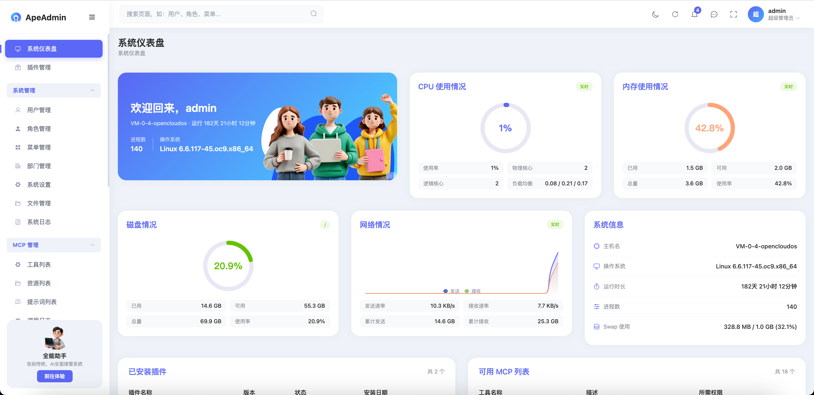
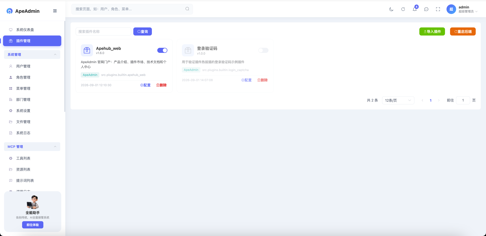
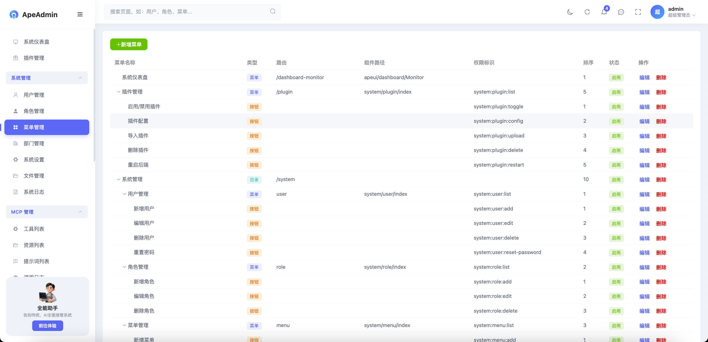
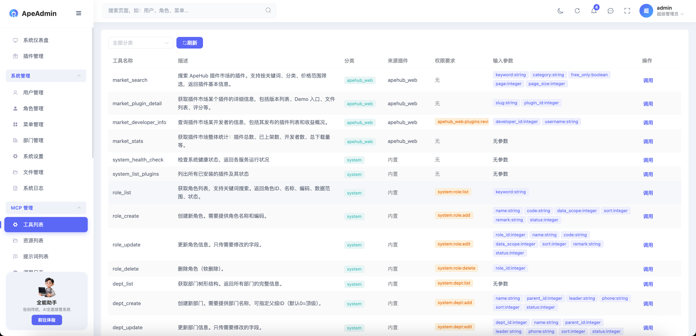

<div align="center">
  <br/>
  
  <h1>ApeAdmin</h1>
  <p>面向现代 AI 应用的开源后台管理框架</p>
</div>

<p align="center">
  <a href="http://apehub.finecv.cn/apehub-web">官网</a> ·
  <a href="http://apehub.finecv.cn/apehub-web/plugins.html">插件市场</a> ·
  <a href="http://apehub.finecv.cn/apehub-web/docs-portal">开发文档</a> ·
  <a href="https://apehub.finecv.cn/admin">在线演示</a>
</p>

<p align="center">
  简体中文 | <a href="README.en.md">English</a>
</p>

<p align="center">
  
  
  
  
  
</p>

---

> **本项目由 AI 驱动开发，人工负责产品与质量。** 人类开发者负责产品方向、架构评审、质量验证与最终决策，AI 负责加速实现、测试和文档。

---

ApeAdmin 是为 AI 应用时代打造的后台开发框架：基于 FastAPI + Vue3 构建平台化管理底座，原生适配 AI Agent 能力调用。

框架的核心理念是**底座与业务解耦**——底座只提供权限、菜单、日志、MCP 网关等基础设施（外加一个教学用示例插件），业务功能全部以插件形式独立开发、独立分发；同时通过 MCP-SSE 网关把管理能力封装为标准化 AI 工具，实现传统业务系统与大模型智能体的无缝打通。

## 目录

- [功能特性](#功能特性)
- [技术栈](#技术栈)
- [快速开始](#快速开始)
- [架构](#架构)
- [插件开发](#插件开发)
- [配置说明](#配置说明)
- [系统截图](#系统截图)
- [贡献指南](#贡献指南)
- [更新历史](#更新历史)

## 功能特性

### 安装向导

WordPress 式开箱体验，无需手工编辑配置文件：

- **自动检测** —— 首次访问自动跳转 `/setup`；已完成安装的系统直接进入后台
- **三步安装** —— 配置数据库 → 配置站点与管理员账号 → 完成
- **自动建库** —— MySQL 数据库不存在时自动创建（utf8mb4）
- **密钥自动生成** —— `JWT_SECRET` 随机生成写入 `.env`
- **安装锁保护** —— `setup.lock` 防止向导被重复执行；安装阶段只建表不跑种子，种子在重启后以新密钥执行，避免加密密钥不一致

### RBAC 权限体系

- **五表模型** —— 用户 / 角色 / 菜单 / 部门 + 关联表
- **四层鉴权** —— 免登录 → 免鉴权 → 规则鉴权 → 数据范围（1=本人 / 2=本部门及以下 / 3=本部门 / 4=全部；数据范围过滤已在用户列表落地，其余资源陆续接入）
- **菜单三类型** —— 目录(M) / 菜单(C) / 按钮(F)，无限层级树形结构
- **超管通配** —— 超级管理员自动拥有所有权限
- **前端权限** —— `v-permission` 指令控制按钮级显示，路由守卫校验页面级权限

### 插件化架构

- **自动发现** —— 插件以 Python 包形式放在 `src/plugins/builtin/`，启动时自动扫描加载
- **ZIP 导入安装** —— 后台「插件管理 → 导入插件」上传 ZIP 即完成安装，运行时生效，无需重启
- **原地升级与回滚** —— 上传新版包自动换码、重注册、保配置，失败自动恢复旧版文件；旧版保留在 `src/plugins/_backups/`（最近 2 份）可手工回滚
- **降级保护** —— 低于当前版本的插件包默认拒绝安装
- **事件总线** —— 7 种内置事件，插件间松耦合通信
- **菜单与 MCP 能力注册** —— 插件自带 `seed.py` 注册菜单权限，可同时注册 MCP 工具暴露给 AI
- **脚手架生成** —— `python -m src.plugins.scaffold my_plugin "显示名" "描述"` 一条命令生成完整插件骨架（含 manifest / 模型 / 路由 / 菜单种子 / MCP 工具示例）
- **插件市场** —— 在线浏览、搜索、下载社区插件

### MCP-SSE 网关

将底座与插件的管理能力对外暴露为 AI Agent 可调用的工具：

- **三原语** —— Tools（工具调用）/ Resources（资源读取）/ Prompts（模板渲染）
- **双传输通道** —— Streamable HTTP（`POST /mcp`，2025-03-26 规范，Bearer JWT + 会话头）+ SSE（旧通道，一次性 ticket 认证，保留兼容）
- **自动 Schema** —— 工具注册时自动从函数签名推断 JSON Schema
- **RBAC 过滤** —— AI Agent 只能看到当前用户有权限调用的工具
- **安全传输** —— JWT 走 Authorization 头；SSE 用一次性 ticket 替代裸 JWT；工具调用 30s 超时保护
- **持久化恢复** —— 服务重启后自动恢复 MCP 工具注册
- **审计日志** —— 每次调用记录请求、响应、耗时、调用者
- **共享分发层** —— 两种通道共用同一套 JSON-RPC 分发器，鉴权/审计/超时行为完全一致

内置 MCP 工具：

| 工具 | 说明 |
|------|------|
| `system_health_check` | 系统健康检查 |
| `system_list_plugins` | 列出已安装插件 |
| `role_list / create / update / delete` | 角色管理（需权限） |
| `dept_list / create / update / delete` | 部门管理（需权限） |
| `menu_list / create / update / delete` | 菜单管理（需权限） |

### AI 全能助手

- **多模型支持** —— DeepSeek / 通义千问 / 智谱 GLM / OpenAI / 自定义端点（OpenAI 兼容接口）
- **后台 run 架构** —— 生成任务在服务端后台执行，切页面、断线、重启浏览器都不中断；前端断线自动重连续传，多次失败降级为一次性查询
- **流式输出** —— SSE 流式 + Markdown 实时渲染 + 代码高亮
- **Function Calling** —— AI 可调用 MCP 工具完成管理操作（多轮工具循环）
- **密钥管理** —— 后台管理供应商密钥，Fernet 加密存储

### 审计日志

- **请求链路追踪** —— 全局唯一请求 ID
- **操作日志** —— 用户操作行为，按模块 / 时间 / 用户筛选
- **请求耗时监控** —— 自动记录 API 耗时

### 其他底座能力

- **双语 i18n** —— 前后端中英双语（`zh-CN` / `en-US`）
- **深色模式** —— 全局主题切换
- **系统自更新** —— 后台上传部署包原地更新，更新前全量备份、已安装插件自动还原
- **测试覆盖** —— 插件热插拔 / 插件升级 / 系统 UPDATE 接口 / 菜单管理 / chat run / 加固项等 43 个用例
- **Redis 可选加速** —— 登录爆破防护 / MCP ticket / token 吊销缓存可走 Redis（多 worker 必需），不可用时自动降级进程内存

## 技术栈

| 层 | 技术 |
|---|---|
| 后端 | FastAPI + SQLAlchemy 2.0 (async) + Alembic |
| 前端 | Vue 3.5 + Vite 6 + TypeScript 5.7 + Element Plus 2.14 |
| 状态管理 | Pinia 2.3 |
| 图表 | ECharts 5.6 + vue-echarts |
| 数据库 | MySQL（aiomysql）/ SQLite（aiosqlite）双驱动自动切换 |
| 缓存 | Redis（可选，缺失自动降级内存） |
| 认证 | JWT（access token）+ bcrypt 密码哈希；token 吊销走 DB 黑名单 + Redis 加速 |
| AI 协议 | MCP (Model Context Protocol) — Streamable HTTP + SSE 双传输 |
| AI 模型 | DeepSeek / 通义千问 / 智谱 GLM / OpenAI（OpenAI 兼容接口） |

## 快速开始

### 在线体验

无需搭建，直接访问线上演示环境：

- **地址**：<https://apehub.finecv.cn/admin>
- **测试账号**：`ceshi110` / `ceshi110`（只读 viewer 角色）

### 方式一：安装向导（推荐）

```bash
# 1. 启动后端
cd backend
python -m venv .venv && .venv/bin/activate    # Windows: .venv\Scripts\activate
pip install -e .
uvicorn src.main:app --reload --host 0.0.0.0 --port 8000

# 2. 启动前端（开发模式）
cd frontend
npm install
npm run dev
```

打开 `http://localhost:5173`，系统检测到未安装会自动进入 `/setup` 向导：

1. **配置数据库** —— SQLite（零配置）或 MySQL（填连接信息，可自动建库）
2. **配置站点** —— 站点名称、管理员账号密码、访问地址
3. **完成安装** —— 写入配置并建表，按提示重启后端，重启后自动初始化管理员与基础数据

### 方式二：生产部署（部署包）

服务器（宝塔面板 / Docker / 裸机 Nginx）部署方案、部署包构建、SQLite→MySQL 迁移，见 **[deploy/DEPLOY.md](deploy/DEPLOY.md)**。

```bash
# 本地构建部署包（底座版，不含业务插件）
bash deploy/build_deploy_package.sh
# 完整版（连带 apehub_web 官网插件）
bash deploy/build_deploy_package.sh --with-apehub
```

部署包只含底座（RBAC / 菜单 / 插件框架 / MCP 网关），解压即 `apeadmin/`，首次启动进入安装向导；业务插件通过后台「导入插件」按需安装（上传 ZIP / 插件市场在线安装）。

### 默认体验路径

1. 登录后台（安装向导中设置的管理员账号）
2. 系统管理 → 用户 / 角色 / 菜单 / 部门 / 插件管理
3. MCP 管理 → 工具 / 资源 / 提示词 / 调用日志
4. AI 助手 → 配置模型密钥后即可对话

## 架构

ApeAdmin 是前后端分离的单体应用，后端插件化扩展，内置安装向导：

```
apeadmin/
├── backend/                       # FastAPI 后端
│   ├── src/
│   │   ├── api/                   # 路由层（REST，前缀 /api/v1）
│   │   │   ├── auth.py            #   认证（登录/登出/刷新令牌）
│   │   │   ├── user.py / role.py / menu.py / dept.py   # RBAC 四表
│   │   │   ├── plugin.py          #   插件管理（上传/启停/升级/回滚）
│   │   │   ├── ai_provider.py     #   AI 模型密钥管理
│   │   │   ├── chat.py / chat_session.py / chat_runs.py  # AI 对话（run 架构）
│   │   │   ├── dashboard.py / log.py / files.py / setting.py / system.py
│   │   ├── core/                  # 基础设施
│   │   │   ├── config.py          #   pydantic-settings 配置
│   │   │   ├── security.py        #   密码哈希 + JWT 签发校验
│   │   │   ├── deps.py            #   FastAPI 依赖注入
│   │   │   ├── middleware.py      #   CORS / 请求追踪
│   │   │   ├── exceptions.py      #   统一异常体系
│   │   │   ├── i18n.py            #   后端双语文案
│   │   │   ├── crypto.py          #   API Key Fernet 加密
│   │   │   ├── auth_guard.py      #   登录爆破防护
│   │   │   ├── pkgdetect.py       #   上传包类型识别（插件/系统更新/Go 包）
│   │   │   └── seed.py            #   种子数据
│   │   ├── ai/                    # AI 智能体
│   │   │   ├── agent.py           #   多模型对话 + 工具调用循环
│   │   │   ├── runner.py          #   后台 run 执行器（状态机 + 断点续传）
│   │   │   └── tools.py           #   MCP 工具列表构建
│   │   ├── mcp/                   # MCP 协议体系
│   │   │   ├── manager.py         #   工具/资源/提示词管理 + RBAC 过滤
│   │   │   ├── routes.py          #   MCP HTTP 路由 + 审计
│   │   │   ├── sse_transport.py   #   SSE 传输
│   │   │   └── decorators.py      #   @mcp_tool 装饰器
│   │   ├── plugins/               # 插件系统
│   │   │   ├── base.py            #   PluginInterface + EventBus
│   │   │   ├── manager.py         #   发现/加载/ZIP安装/升级/回滚
│   │   │   ├── scaffold/          #   插件脚手架（生成骨架）
│   │   │   └── builtin/           #   内置插件（目录动态扫描）
│   │   │       └── dev_example/   #     插件开发示例（唯一随包分发的示例）
│   │   ├── models/ crud/ schemas/ # ORM 模型 / 泛型 CRUD / Pydantic 模型
│   │   ├── setup_wizard/         # 安装向导（未安装时挂载 /setup）
│   │   ├── cli.py                 # 命令行工具（serve/init-db/seed/plugins）
│   │   └── main.py                # 应用入口（lifespan + setup 模式切换）
│   ├── alembic/                   # 数据库迁移
│   ├── tests/                     # 43 个测试用例（插件/AI run/更新/加固）
│   └── pyproject.toml
│
├── frontend/                      # Vue3 前端
│   ├── src/
│   │   ├── api/                   # Axios 封装 + 接口定义
│   │   ├── components/            # ApeHeader / ApeSidebar / 版本更新弹窗
│   │   ├── composables/           # useTheme（深浅切换）
│   │   ├── directives/            # v-permission 权限指令
│   │   ├── router/                # 动态路由（菜单树 → 路由，import.meta.glob）
│   │   ├── stores/                # Pinia（用户/权限/菜单/AI 对话状态）
│   │   ├── locales/               # 中英双语（zh-CN / en-US）
│   │   └── views/                 # 页面：system / mcp / ai / login / error / dev_example
│   └── package.json
│
└── deploy/                        # 部署物料
    ├── DEPLOY.md                  # 生产部署文档
    ├── build_deploy_package.sh    # 部署包构建（底座版/完整版）
    ├── nginx/                     # Nginx 站点配置模板
    └── scripts/                   # 服务器部署/管理/备份脚本
```

### 设计原则

1. **底座与插件解耦** —— 底座只提供基础设施 + `dev_example` 教学示例；业务插件（官网门户、AI 助手类等）以独立插件包分发，不进底座仓库与安装包
2. **安装即用** —— 未安装自动进 `/setup`；SQLite 零配置起步，MySQL 生产切换
3. **权限贯穿 AI** —— MCP 工具与 AI Function Calling 均受 RBAC 控制，AI 只能操作用户有权限的资源
4. **动态路由** —— 前端路由由后端菜单树生成，菜单增减无需改前端代码
5. **可恢复设计** —— 插件升级失败自动回滚；系统更新前全量备份；AI 生成断线可续

## 插件开发

### 创建插件（脚手架，推荐）

```bash
cd backend
python -m src.plugins.scaffold my_plugin "我的插件" "插件描述"
# 生成 src/plugins/builtin/my_plugin/：
#   plugin.json / plugin.py / models.py / api.py / seed.py / mcp_tools.py
```

### 手工创建

在 `backend/src/plugins/builtin/` 下创建 Python 包：

```
my_plugin/
  __init__.py
  plugin.json       # 清单（name/version/dependencies）
  plugin.py         # 入口（实现 PluginInterface）
  models.py         # ORM 模型（可选）
  api.py            # 路由（可选）
  seed.py           # 菜单/权限注册（可选）
  mcp_tools.py      # MCP 工具（可选）
```

### 插件接口

```python
from src.plugins.base import PluginInterface, PluginInfo

class MyPlugin(PluginInterface):
    @property
    def info(self) -> PluginInfo:
        return PluginInfo(name="my-plugin", version="1.0.0", ...)

    def on_load(self): ...            # 加载时调用
    async def install(self): ...      # 安装（可建表）
    async def uninstall(self): ...    # 卸载
    def register(self, app): ...       # 注册 FastAPI 路由
    def register_mcp_tools(self): ... # 注册 MCP 工具（暴露给 AI）
    def unregister(self, app): ...    # 反注册
    async def before_login(self, payload): ...  # 登录前钩子
```

> 完整示例参考 `backend/src/plugins/builtin/dev_example/`（含模型、路由、菜单注册、事件订阅、MCP 工具五件套）与 [docs/plugin-mcp-guide.md](docs/plugin-mcp-guide.md)。

### 事件类型

| 事件 | 触发时机 |
|------|----------|
| `APP_STARTUP` / `APP_SHUTDOWN` | 应用启停 |
| `DB_READY` | 数据库初始化完成 |
| `USER_LOGIN` / `USER_LOGOUT` | 用户登录登出 |
| `BEFORE_REQUEST` / `AFTER_REQUEST` | 请求处理前后 |

### 分发插件

1. 把插件目录打成 ZIP（含 `plugin.json`）；
2. 后台「插件管理 → 导入插件」上传，运行时安装，无需重启；
3. 可发布到插件市场供在线安装（`apehub.finecv.cn/apehub-web/plugins.html`）。

> 前端页面需在主前端工程中构建（底座 `frontend_dist` 携带页面 chunk），插件 ZIP 负责后端逻辑与菜单注册。

## 配置说明

安装向导自动生成 `.env`；手工配置参考（后端目录 `.env` 或环境变量）：

| 配置项 | 默认值 | 说明 |
|--------|--------|------|
| `DB_TYPE` | sqlite | 数据库类型 (sqlite / mysql) |
| `DB_HOST` / `DB_PORT` / `DB_USER` / `DB_PASSWORD` | localhost / 3306 / root / — | MySQL 连接 |
| `DB_NAME` | apeadmin | 数据库名 |
| `REDIS_URL` | redis://localhost:6379/1 | Redis（可选，缺失降级内存） |
| `JWT_SECRET` | 安装时自动生成 | JWT 签名密钥 |
| `JWT_EXPIRE_MINUTES` | 1440 | access token 有效期（分钟） |
| `JWT_REFRESH_EXPIRE_DAYS` | 7 | refresh token 有效期（天） |
| `CORS_ORIGINS` | localhost:5173,localhost:8000 | CORS 白名单 |
| `ADMIN_PATH` | /admin | 管理后台访问路径 |
| `SITE_URL` | — | 站点对外访问地址 |
| `MCP_ENABLED` | true | 启用 MCP 网关 |
| `PLUGINS_ENABLED` | true | 启用插件系统 |
| `SUPER_ADMIN_USERNAME` / `SUPER_ADMIN_PASSWORD` | admin / admin123 | 超管种子账号（仅首次） |

### AI 模型配置

在管理后台 → AI 助手 → 模型密钥管理中添加：

| 供应商 | 默认模型 | Base URL |
|--------|----------|----------|
| DeepSeek | deepseek-chat | `https://api.deepseek.com` |
| 通义千问 | qwen-plus | `https://dashscope.aliyuncs.com/compatible-mode/v1` |
| 智谱 GLM | glm-4-flash | `https://open.bigmodel.cn/api/paas/v4` |
| OpenAI | gpt-4o-mini | `https://api.openai.com/v1` |
| 自定义 | — | 任意 OpenAI 兼容端点 |

## 系统截图

<table>
  <tr>
    <td width="50%" align="center">
      <br/>
      <sub><b>登录</b></sub>
    </td>
    <td width="50%" align="center">
      <br/>
      <sub><b>仪表盘</b></sub>
    </td>
  </tr>
  <tr>
    <td width="50%" align="center">
      <br/>
      <sub><b>插件管理</b></sub>
    </td>
    <td width="50%" align="center">
      <br/>
      <sub><b>系统管理</b></sub>
    </td>
  </tr>
</table>

## 贡献指南

### 如何贡献

1. **Fork** 仓库
2. 克隆你的 fork：
   ```bash
   git clone https://github.com/<你的用户名>/ApeAdmin.git
   cd ApeAdmin
   ```
3. 创建分支：`git checkout -b feat/your-feature`
4. 修改代码并验证：
   ```bash
   # 后端（含测试）
   cd backend && pip install -e . && uvicorn src.main:app --reload
   pytest tests/ -q

   # 前端
   cd frontend && npm install && npm run dev
   ```
5. 写清晰的 commit：`git commit -m "feat: add xxx support"`
6. **Push** 并向 `master` 提交 **Pull Request**

### 分支命名

| 前缀 | 用途 |
|------|------|
| `feat/` | 新功能 |
| `fix/` | Bug 修复 |
| `refactor/` | 重构（不改变行为） |
| `docs/` | 仅文档 |
| `chore/` | 构建、CI、工具链 |

### 约定

- 插件保持独立，不直接依赖其他插件
- 业务插件不进底座仓库与安装包，以独立插件包分发
- 破坏性操作必须需要用户确认
- API 遵循 RESTful 风格，前缀 `/api/v1`
- 提交前确保后端可启动、前端可编译、测试通过

## 更新历史

| 版本 | 日期 | 要点 |
|------|------|------|
| v2.9.0 | 2026-11-23 | 架构三项：MCP 新增 Streamable HTTP 传输（共享 JSON-RPC 分发层）；Redis 真正启用（爆破防护/ticket/吊销缓存，可降级内存）；插件 MetaData 隔离（``make_plugin_base``）＋脚手架同步 |
| v2.8.2 | 2026-11-21 | 修复全新克隆无法构建的库内残留（Plugins.vue 误入库）；README 重写 |
| v2.8.1 | 2026-11-20 | 依赖升级：后端 10 项小版本跟升＋greenlet 显式锁定；前端删 9 死依赖、sortablejs 转正；恢复 vue-tsc 完整检查 |
| v2.8.0 | 2026-11-19 | 插件分层：hermes 整份移出底座仓库与安装包，底座只保留底座代码 + dev_example |
| v2.7.0 | 2026-11-05 | AI 对话并行 run 架构 + qm 风格 UI；hermes 插件入库（v2.8.0 已回退） |
| v2.6.0 | 2026-11-04 | AI 对话后台 run 架构上线 |

## 社区交流

---

用微信扫描下方二维码联系作者加入 ApeAdmin 用户群，反馈问题、分享使用心得：

<p align="center">
  
</p>

## License

MIT
